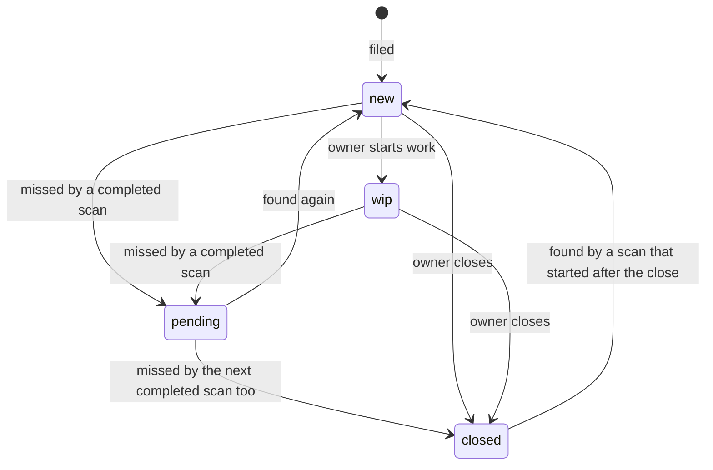

# continuum-github

continuum-github tracks the findings of AWS Continuum and AWS Security Agent as GitHub issues and posts a weekly report. Two composite actions run from workflows in a private repository that you own. The `sync` action reads the scan results, files each finding of Medium severity or higher as an issue, and keeps the issues up to date. The `report` action posts a weekly summary issue and uploads a visual report as a workflow artifact.

This is an unofficial tool. It is not affiliated with or endorsed by Amazon Web Services.

## What it reads

The tool reads three kinds of scan, which you set up in AWS yourself:

- code-review: the Security Agent full repository code review of each public repository. Security Agent has no schedule for code reviews, so the `sync` action starts one per repository every week.
- code-vuln: Continuum for Code Vulnerabilities, which scans each private repository on the schedule of its Continuum environment.
- pentest: Continuum for Penetration Testing, which attacks a site over HTTPS with the site's source repository as context. A schedule in AWS starts each pentest.

### How code-vuln and code-review differ

Both look for vulnerabilities in a repository's source code and try to exploit what they find to confirm it. code-review deploys the application in a simulated environment for that, and code-vuln runs a proof of concept in a sandbox. They differ in what each does with the result:

| | code-vuln | code-review |
|---|---|---|
| Findings it reports | Only findings that validation proved exploitable become Continuum issues | All findings, each with a `validationStatus` that says whether validation confirmed it |
| Severity | Reassessed against the AWS environment that a collector reads from AWS Config, such as whether anything can reach the code; final once the issue's status is `COMPLETED` | Assessed from the code alone |
| Fixes | A patch that Continuum checks against the proof of concept and the project's tests, opened as a pull request | None, because a fix pull request in a public repository would disclose the vulnerability |
| Repeat findings | Continuum keeps each issue across scans and folds a repeat finding into it | Each run returns its own findings, and sync matches them to existing issues |
| Repositories | Private only, because Continuum rejects public repositories | Public |

## Requirements

- An AWS account with AWS Security Agent and AWS Continuum, an Agent Space connected to your repositories through the Security Agent GitHub App, and the code reviews, code-vuln environments, and pentests you want. [examples/infra/](examples/infra/) has CloudFormation templates to start from.
- An IAM role that GitHub Actions can assume through OIDC, such as the one in [examples/infra/github-actions-role.yaml](examples/infra/github-actions-role.yaml).
- A private GitHub repository to hold the issues and run the workflows.
- Optionally, access to a model in Amazon Bedrock. With a model, the actions add a summary and two short explanations to each issue, summarize each severity in the weekly report, and write a visual report, all in the language that the `language` input names. Without one, the issues and the report hold only what the scans returned.

[docs/setup.md](docs/setup.md) walks through the setup.

## Usage

List the repositories and sites in a `targets.toml` at the root of the repository, as in [examples/targets.toml](examples/targets.toml). Then add a workflow that calls the `sync` action:

```yaml
name: Sync findings

on:
  schedule:
    - cron: "7 */2 * * *"
  workflow_dispatch:

permissions:
  contents: read

concurrency:
  group: continuum-github
  cancel-in-progress: false

jobs:
  sync:
    if: github.ref == 'refs/heads/main'
    runs-on: ubuntu-latest
    timeout-minutes: 20
    permissions:
      contents: read
      id-token: write
      issues: write
    steps:
      - uses: actions/checkout@3d3c42e5aac5ba805825da76410c181273ba90b1  # v7.0.1
        with:
          persist-credentials: false
      - uses: aws-actions/configure-aws-credentials@e1253824e5c10ff9df46874f81ed3ec929e19cfd  # v6.3.0
        with:
          role-to-assume: ${{ vars.AWS_ROLE_ARN }}
          aws-region: us-east-1
      - uses: rewse/continuum-github/sync@0000000000000000000000000000000000000000  # vX.Y.Z
        with:
          agent-space-id: ${{ vars.AGENT_SPACE_ID }}
          bedrock-model-id: ${{ vars.BEDROCK_MODEL_ID }}
          language: ${{ vars.LANGUAGE }}
```

Add a second workflow that calls the `report` action once a week:

```yaml
name: Weekly report

on:
  schedule:
    - cron: "35 21 * * 5"
  workflow_dispatch:

permissions:
  contents: read

concurrency:
  group: continuum-github
  cancel-in-progress: false

jobs:
  report:
    if: github.ref == 'refs/heads/main'
    runs-on: ubuntu-latest
    timeout-minutes: 40
    permissions:
      contents: read
      id-token: write
      issues: write
    steps:
      - uses: actions/checkout@3d3c42e5aac5ba805825da76410c181273ba90b1  # v7.0.1
        with:
          persist-credentials: false
      - uses: aws-actions/configure-aws-credentials@e1253824e5c10ff9df46874f81ed3ec929e19cfd  # v6.3.0
        with:
          role-to-assume: ${{ vars.AWS_ROLE_ARN }}
          aws-region: us-east-1
      - id: report
        uses: rewse/continuum-github/report@0000000000000000000000000000000000000000  # vX.Y.Z
        with:
          agent-space-id: ${{ vars.AGENT_SPACE_ID }}
          bedrock-model-id: ${{ vars.BEDROCK_MODEL_ID }}
          language: ${{ vars.LANGUAGE }}
      - name: Link the HTML report
        env:
          HTML_URL: ${{ steps.report.outputs.html-url }}
        run: echo "[HTML report]($HTML_URL)" >> "$GITHUB_STEP_SUMMARY"
```

The last step is optional. It links the HTML report from the run's summary page, using the `html-url` output. [examples/workflows/](examples/workflows/) has both workflows in full. Replace the placeholder SHA of zeros and `vX.Y.Z` with the commit SHA and version of a release. Once the reference is a real SHA with its version comment, Dependabot's `github-actions` updates keep it current. Give both workflows the same concurrency group so that one waits for the other.

Both actions accept these inputs:

| Input | Default | Description |
|---|---|---|
| `agent-space-id` | required | ID of the Security Agent space |
| `aws-region` | `us-east-1` | Region of the Agent Space and the Continuum environments |
| `bedrock-model-id` | empty | Bedrock model or inference profile ID, such as `global.anthropic.claude-sonnet-5-5`; empty turns the model off |
| `bedrock-region` | empty | Region that Bedrock is called in; empty uses `aws-region` |
| `github-token` | `${{ github.token }}` | Token that reads and writes issues in the report repository; keep the default (see below) |
| `language` | `en_US` | Locale, such as `ja_JP`, of the text the model writes; empty uses `en_US` |
| `mention` | empty | Mention, such as `@example-user`, added to urgent issues; empty adds none |
| `report-repository` | `${{ github.repository }}` | Repository, as `owner/name`, that holds the issues; keep the default (see below) |
| `targets` | `targets.toml` | Path of the targets file in the checkout |

Only the defaults of `github-token` and `report-repository` are supported. The actions read their state back only from issues opened by `github-actions[bot]`, the author of issues created with `github.token`. With a personal access token, a GitHub App token, or another repository, sync does not recognize the issues it filed and files every finding again. Run the workflows in the report repository itself.

The `report` action has the output `html-url`, the URL of the uploaded HTML report. It is empty when the model is off or could not write the report.

## What becomes an issue

Every finding of Critical, High, or Medium severity gets one issue in the report repository. A pentest or code-review finding with an unknown severity counts as Medium. Low and Informational findings get no issue and do not appear in the report.

A finding is filed once its result is settled:

| Scan | Filed when |
|---|---|
| code-review | Its job completes |
| code-vuln | Continuum's issue reaches status `COMPLETED`, because its severity is provisional until then |
| pentest | Its validation ends, or its job completes if validation never ends |

An issue is `urgent` when the finding is Critical, or High and confirmed by validation. Every code-vuln finding is confirmed, so all of its High findings are urgent. When the `mention` input is set, an urgent issue mentions it at the top, and an issue that becomes urgent later gets a comment with the mention.

The `sync` action files an issue with the scan's details first. When `bedrock-model-id` is set, it then asks the model to add Summary, Why it matters, and Risk if left unresolved sections. The model gets every detail except a pentest's Attack script, because Bedrock's safety filter tends to block prompts that carry one. If the model fails after the retries, the issue keeps only the details and ends with a note saying so, and a later run tries again. Setting `bedrock-model-id` later adds the sections to open issues that lack them, and clearing it leaves written sections in place.

### Issue body

With `bedrock-model-id` set, the body of a code-review issue looks like this. The finding is made up, and the state marker at the end is shortened:

```markdown
| Field | Value |
|---|---|
| Severity | HIGH |
| Type | code-review |
| Repository | example-app |
| Location | src/api/export.py:42-51 |
| Confidence | HIGH |
| Detected | 2026-11-16T03:12:45+00:00 |
| Continuum ID | 0f3c9a6e-5b1d-4e2a-9c7f-2d8e4b6a1c03 |

## Summary

The export endpoint puts the `sort` query parameter into an SQL statement without checking it, so a request can run its own SQL.

## Why it matters

Anyone who can call the endpoint can read tables other than the one being exported, including user records.

## Risk if left unresolved

An attacker can copy the whole database, and the leak is hard to notice because the requests look like normal exports.

<details><summary>Details from Continuum</summary>

### Description

The handler builds the ORDER BY clause by concatenating the sort parameter...

### Reasoning

The parameter reaches cursor.execute without passing through an allowlist...

</details>

<!-- continuum-state: {"finding_ids":["0f3c9a6e-..."],...} -->
```

Without a model, the body has the same table, details, and state marker, and none of the three sections:

```markdown
| Field | Value |
|---|---|
| Severity | HIGH |
| Type | code-review |
...

<details><summary>Details from Continuum</summary>

### Description

The handler builds the ORDER BY clause by concatenating the sort parameter...

### Reasoning

The parameter reaches cursor.execute without passing through an allowlist...

</details>

<!-- continuum-state: {"finding_ids":["0f3c9a6e-..."],...} -->
```

When the model is on but fails after the retries, the body has the same layout as without a model and adds this note before the state marker:

```markdown
_Bedrock could not write the Summary, Why it matters, and Risk if left unresolved sections, so this issue shows the scanner's details only. A later sync tries again._
```

The rows of the table depend on the scan: a pentest issue has Site instead of Location, and a code-vuln issue has neither. The headings inside the details also come from the scan, such as Attack script for a pentest or Synopsis and Severity reasoning for code-vuln.

### Language

The model writes the sections, the summaries, and the visual report in the locale that the `language` input names. A locale is a lowercase language code with an optional uppercase region, such as `ja`, `ja_JP`, or `zh_TW`. Any other value fails the action, even when the model is off. With `language: ja_JP`, the three sections in the example above are in Japanese, and the rest of the body stays the same. The headings, tables, comments, and notes that the actions write stay in English. Changing `language` does not rewrite sections already written; new issues and issues without sections get the new language.

## Handling an issue

Use the GitHub controls:

- Add `wip` when you start work on it.
- Close it as completed once fixed, and name the fixing commits in a comment. For a pentest issue, sync then starts a revalidation of that finding. If the finding reproduces, sync reopens the issue as `new`; otherwise it comments that the finding was revalidated and leaves the issue closed. code-review and code-vuln have no revalidation, so the next weekly scan decides.
- Close it as not planned, with the reason in a comment, when you accept the risk or the finding is a false positive. Sync never reopens these issues, and the weekly report leaves them out.
- Use Close as duplicate when two issues describe the same finding. Sync moves the duplicate's finding IDs to the issue it duplicates and does not reopen the duplicate.

## Issue states and labels

| Kind | Labels |
|---|---|
| State | `new`, `wip`, `pending` (one at a time) |
| Severity | `severity:critical`, `severity:high`, `severity:medium` |
| Source | `code-review`, `code-vuln`, `pentest` |
| Target | `repo:<name>`, `site:<domain>` (pentest only) |
| Priority | `urgent` |



Only completed scans of the issue's own target move it: the site's pentest, the repository's code review, or the repository's code-vuln environment. A failed or unfinished scan changes nothing. After two completed scans in a row miss a finding, sync closes the issue as completed with a comment. If a scan that started after the close finds it again, sync reopens the issue as `new` and comments.

When a scan changes a finding's severity or validation result, sync updates the labels, the title, and the table at the top of the issue. When Continuum or Security Agent withdraws a finding, or a code-vuln issue settles below Medium, sync comments, removes the severity and `urgent` labels, and closes the issue as not planned. If a later scan finds the finding again at Medium or above, sync reopens the issue with its labels.

code-review findings carry no ID that stays the same across runs, so sync matches them by code review, risk type, name (ignoring case and runs of spaces), and the path of the first code location. A finding that a later run names differently becomes a new issue, and the old one closes after two misses.

Sync reads state only from issues that `github-actions[bot]` created, and ignores hidden markers in anyone else's issues. Create the labels with `continuum-github setup labels` before the first run, as [docs/setup.md](docs/setup.md) describes, because GitHub can drop a label that the token is not allowed to create.

## Weekly report

The `report` action posts an issue titled `Continuum weekly report YYYY-Www` with the label `weekly-report`. The body counts open, new, and closed findings per severity and per repository, names the scans that did not complete, and lists the open findings and the findings closed that week in collapsed sections. A list that does not fit in the body continues in comments. Findings closed as not planned by the owner or as duplicates do not count as closed.

When `bedrock-model-id` is set, the model also summarizes each severity that has open findings and writes a visual report as a single HTML file, which the action uploads as an artifact kept for 400 days and links from the issue. A part the model fails to write after the retries is left out, and the body ends with a note that names it. Without a model, the report has neither part and no note. Posting a report closes the previous week's report, and a rerun in the same week rewrites that week's report.

## Code reviews

A code review is due when it has no running job and no completed job that started in the last 6.5 days. Security Agent runs at most 10 code review jobs at once, so sync starts the due reviews oldest first, as many as fit next to the jobs already running. A review that does not fit, or whose start Security Agent throttles, waits for the next run.

## Confidentiality

The issues and the report artifact hold details of vulnerabilities that may not be fixed yet, so keep the report repository private. The `continuum-github` CLI prints only counts and target names to the workflow log. Finding details go to the issues and, inside the job, to the Bedrock model. Do not echo them in your own workflow steps, and do not copy them to public repositories.

## Development

See [AGENTS.md](AGENTS.md) for the validation commands and the rules for handling finding details.

## License

[MIT](LICENSE)
